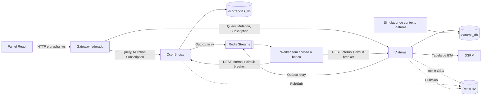

# SDV — Plano de aderência à arquitetura documentada

Base da análise: commit `7d53886`, comparado com `Documentação Técnica - SDV.md` e com o PDF `SDV - Sistema de Despacho de Viaturas` (11 slides).

Este plano define o que será implementado, o que será mantido diferente e por quê. Nenhum item abaixo está implementado ainda. Cada critério só poderá ser marcado como **PASSOU**, **FALHOU** ou **BLOQUEADO** com teste executável, log e SHA, conforme o `AGENTS.md`.

## 1. Decisões que precisam de confirmação

| # | Decisão | Recomendação | Impacto |
|---|---|---|---|
| D1 | Failover real exige sair da regra "Single-AZ" do `AGENTS.md` | Adotar `ha_enabled=true` como alvo e atualizar o `AGENTS.md`; o `terraform apply` continua dependendo de autorização explícita | Aumenta o custo AWS: 2 RDS Multi-AZ, Redis com réplica e no mínimo 2 tarefas por serviço |
| D2 | Runtime do gateway para subscriptions federadas | **Hive Gateway** (seção 4.3); Apollo Router v2 fica como plano B | Troca o runtime do gateway, mas mantém os subgrafos Apollo Federation v2 |
| D3 | Domínio próprio para `api.` e `staging.api.` | Parametrizar em Terraform; sem domínio, o item fica BLOQUEADO | Necessário também para HTTPS entre CloudFront e ALB |

## 2. Arquitetura-alvo

Princípios: cada banco tem um único dono, o worker orquestra sem credencial de banco, o PostgreSQL decide o estado e o Redis coordena, transporta e acelera.

## 3. Matriz de diferenças

Legenda: **Implementar** (falta), **Completar** (parcial), **Manter** (diferente, mas justificado; a documentação será corrigida).

### 3.1 Não implementado

| Item documentado | Situação atual | Ação | Fase |
|---|---|---|---|
| Circuit breaker entre serviços | Só existe o `deployment_circuit_breaker` do ECS, que trata de deploy | **Implementar** com `opossum` nas chamadas do worker e no OSRM | F2 |
| Retry com backoff exponencial | Intervalos fixos | **Implementar** com jitter, apenas para erro transitório | F2 |
| Rate limit por IP ou central no gateway | Só no login, em memória | **Implementar** com contadores no Redis | F4 |
| Limite de profundidade e complexidade | Ausente | **Implementar** | F4 |
| Helmet | Ausente | **Implementar** no gateway; CSP do painel via CloudFront | F4 |
| Auto scaling 80% / 30% | Réplicas fixas | **Implementar** step scaling de CPU e memória | F6 |
| Cache quente de posições no Redis | Ausente | **Implementar** com `GEOADD`/`GEOSEARCH` | F3 |
| Dev, Staging e Prod | Um ambiente | **Implementar** com GitHub Environments e `var.environment` | F6 |
| DNS externo por ambiente | Sem Route 53 | **Implementar** de forma parametrizada (D3) | F6 |
| Failover | Single-AZ, sem réplica | **Implementar** (D1) | F6 |

### 3.2 Implementado parcialmente

| Item | Por que ficou parcial | Ação | Fase |
|---|---|---|---|
| Database-per-service | O worker foi criado como atalho para evitar transação distribuída e escreve nos dois bancos; uma única instância e todas as tarefas recebem as duas URLs | **Completar** (seção 4.1) | F1, F6 |
| Subscriptions | `@apollo/gateway` não executa subscriptions, então foi criado um schema paralelo que só avisa o cliente | **Completar** (seção 4.3) | F4 |
| Autorização por central | Escrita é restrita; leitura é global; existe um único papel | **Completar**: `OPERADOR` e `ADMIN`, ocorrências filtradas pela central do token, frota compartilhada visível | F5 |
| Balanceamento | ALB só no gateway; internos em DNS, e o keep-alive tende a fixar o tráfego em uma réplica | **Completar** com ALB interno e zona privada `sdv.internal` | F6 |
| Connection draining | Só padrões | **Completar**: `deregistration_delay`, `stopTimeout` e fechamento ordenado de conexões | F6 |
| Connection pooling | Prisma no padrão | **Completar** com `connection_limit` explícito, seguindo `réplicas_máx × limite + relay + reserva < max_connections` | F6 |
| Durabilidade do stream | AOF só no Compose; o PostgreSQL é a fonte real | **Completar** (seção 4.4) | F2, F6 |
| Serviços stateless | Contador de login em memória | **Completar** movendo para o Redis | F4 |
| Viatura mais próxima | Haversine no despacho, OSRM só na prévia | **Completar** (seção 4.5) | F3 |
| Fila com recuperação | Sem dead-letter queue e sem limite de tamanho | **Completar** com DLQ após 5 entregas e `MAXLEN ~` | F2 |
| HS256/RS256 | Segredo simétrico compartilhado; qualquer serviço conseguiria emitir tokens | **Completar** com RS256: chave privada só em Ocorrências | F5 |
| TLS interno | CloudFront fala HTTP com o ALB | **Completar** após D3 | F6 |

### 3.3 Diferente, e mantido com justificativa

| Documentado | Real | Por que manter |
|---|---|---|
| Mutation faz `XADD` | Outbox transacional | Gravar no banco e no Redis sem transação comum pode perder o evento; a Outbox elimina essa escrita dupla |
| `201 Created` | HTTP 200 | GraphQL sobre HTTP responde 200; a criação é expressa no payload |
| Status FILA e PROCESSANDO | Sem esses status | Duram milissegundos e custariam duas escritas por evento; os status reais refletem estados operacionais |
| Mutations disputam a viatura | Despacho automático pelo worker | É o que garante a proposta "a mais próxima é despachada"; a disputa continua existindo entre duas ocorrências simultâneas |
| FIFO estrito | Prioridade na fila de espera | Em emergência, a prioridade deve vencer a ordem de chegada |
| REST interno não destacado | `/internal/*` | Comandos entre serviços não devem ser expostos no supergrafo |
| GitHub Secrets / Docker Secrets | OIDC + Secrets Manager | Elimina credenciais de longa duração |
| PgBouncer | Pool nativo com limites | A própria documentação admite "PgBouncer ou nativo do Prisma" |
| Lock como garantia única | Lock + PostgreSQL | Seção 4.2 |

## 4. Decisões de arquitetura

### 4.1 Database-per-service de verdade

O problema está em [`dispatch-worker`](../apps/dispatch-worker/src/main.ts), que abre conexões com os dois bancos e altera tabelas de Ocorrências e de Viaturas.

1. **Relay por serviço.** Cada serviço publica a própria Outbox no próprio stream (`sdv:ocorrencias` e `sdv:viaturas`), com `FOR UPDATE SKIP LOCKED`.
2. **Worker sem banco.** O worker vira um orquestrador de saga: consome os streams e chama `/internal/*` do serviço dono do dado.
3. **Projeção dentro do dono.** Eventos de frota são aplicados por Ocorrências em `POST /internal/eventos-frota`, idempotente por `eventIdOrigem`.
4. **Ordem de eventos.** Hoje a leitura é serial; com streams, `VIATURA_CHEGOU` pode chegar antes de `DESPACHO_CONFIRMADO`. A projeção passa a ser monotônica por posição na máquina de estados, com teste de eventos fora de ordem.
5. **Reconciliação no dono.** A varredura de pendentes passa para Ocorrências e continua funcionando sem Redis.
6. **Simulador.** Já acessa apenas `viaturas_db`. Passa para `apps/viaturas-service/src/simulator` como segundo processo do mesmo contexto, deixando a fronteira visível no repositório.
7. **Isolamento físico.** Dois PostgreSQL no Compose (5432 e 5433), duas instâncias RDS, usuário próprio por banco, segredos, execution roles e security groups por serviço.
8. **Verificação.** `scripts/check-service-boundaries.mjs` no CI e um teste provando que a credencial de um serviço é recusada no banco do outro. Scripts de teste e de bootstrap podem acessar os dois bancos, pois não são serviços.

### 4.2 Redis lock: por que ele não será a garantia final

**Decisão: o lock é a primeira barreira e a principal coordenação de concorrência; a garantia final é do PostgreSQL.** O slide 6 será ajustado para mostrar as duas camadas. O `AGENTS.md` também define o PostgreSQL como canônico.

O lock sozinho não garante exclusão mútua, por quatro motivos:

1. **TTL.** Se o processo pausar por GC ou rede além dos 10 s, o lock expira, outro processo o obtém e o primeiro continua escrevendo.
2. **Failover.** A replicação do Redis é assíncrona. Se o primário cair logo após o `SET NX`, a réplica promovida não conhece o lock e dois processos o obtêm. Como este plano exige failover, a falha passa a ser um cenário previsto.
3. **Sem atomicidade.** Lock e transação vivem em sistemas diferentes; não há commit conjunto.
4. **Sem fencing.** O banco precisa rejeitar o portador de um lock vencido. É exatamente o papel do `UPDATE ... WHERE status='DISPONIVEL'` e do índice `uq_viatura_despacho_ativo`.

O lock continua valioso: evita transações fadadas a perder, reduz contenção e faz o perdedor passar logo para a próxima viatura.

Mudanças:

- Se o Redis cair, o despacho segue sem lock e registra `lock_degradado`; hoje o erro interrompe a alocação.
- Métricas `lock_obtido`, `lock_ocupado`, `lock_degradado` e `cas_perdido`, para mostrar o lock atuando na demonstração.

Matriz de teste (duas centrais, **uma** viatura disponível, que o teste atual não força):

| Cenário | Resultado exigido |
|---|---|
| Lock ativo | 1 despacho, 1 ocorrência em `AGUARDANDO_VIATURA`, `lock_ocupado` ≥ 1 ou `cas_perdido` = 0 |
| Lock desligado (flag só de teste) | 1 despacho; o PostgreSQL resolve e `cas_perdido` ≥ 1 |
| Lock expira durante a transação | 1 despacho |
| Redis indisponível | 1 despacho e `lock_degradado` ≥ 1 |

**Texto sugerido para o slide:** "Redis Lock coordena a disputa. PostgreSQL garante a invariante: mesmo se o lock falhar, não há despacho duplo."

### 4.3 Subscriptions federadas

`@apollo/gateway` não executa subscriptions, por isso o sistema mantém hoje um schema separado. Opções avaliadas:

| Critério | Hive Gateway | Apollo Router v2 |
|---|---|---|
| Subscriptions federadas | Sim, resolvendo campos de outros subgrafos a cada evento | Sim |
| Conexão do navegador | `graphql-ws`, o mesmo cliente atual | Multipart HTTP, exige trocar o cliente; não aceita WebSocket do cliente |
| Dependência externa | Nenhuma | Conta GraphOS, com limites no plano Free |
| Código atual de borda (`/auth`, CORS, limites) | Continua em Node | Requer Rhai ou coprocessador |
| Testes de reconexão | Preservados | Precisam ser reescritos |

**Recomendação: Hive Gateway.** Os subgrafos seguem Apollo Federation v2; muda apenas o runtime da composição, e isso será registrado nas diferenças.

Implementação:

- Ocorrências expõe `ocorrenciaAtualizada`, filtrada pela central do token. `viatura` é resolvida pelo subgrafo de Viaturas, tornando a federação efetiva no evento.
- Viaturas expõe `viaturaAtualizada`, `despachoAtualizado` e `simulacaoAtualizada`.
- Canais Pub/Sub por serviço e **uma conexão Redis por réplica**; hoje cada subscription abre uma conexão.
- Gateway para subgrafo por SSE, transporte recomendado pela documentação do Hive; WebSocket é o plano B.
- Supergrafo estático composto no CI, para o gateway não depender dos subgrafos no boot.
- O painel recebe entidades tipadas e **continua refazendo a consulta ao reconectar**, pois o Pub/Sub é transitório.
- `eventoSDV` e o schema paralelo são removidos.

PoC obrigatória antes da troca (critério de saída): subscription com campo de outro subgrafo, propagação do JWT, fechamento `4403` na expiração, reconexão e compatibilidade com o limite de profundidade. Se algum falhar, a troca vai para o Apollo Router.

### 4.4 Failover e durabilidade

| Falha | Comportamento-alvo | Prova |
|---|---|---|
| Worker cai | `XAUTOCLAIM` retoma | Teste local |
| Viaturas fora | Circuit breaker abre, mensagens ficam no stream, ocorrências seguem sendo abertas | Teste local |
| Redis primário cai | Promoção automática; clientes reconectam | Compose com Sentinel |
| Evento perdido no failover | Republicado por falta de confirmação | Teste local |
| PostgreSQL reinicia | Reconexão sem duplicidade | Teste local |
| Failover RDS | Multi-AZ | `reboot --force-failover`: BLOQUEADO até haver autorização |
| Tarefa ou AZ cai | Outra AZ continua servindo | Só em ambiente AWS autorizado |

Pontos centrais:

- O PDF promete "persistência garantida em disco", mas a replicação do ElastiCache é assíncrona. Para não haver perda silenciosa, a Outbox passa a ter `confirmadoEm`: o evento só é considerado entregue depois de aplicado, e o relay republica o que não foi confirmado.
- `WAIT` após o `XADD` reduz a janela de perda.
- Terraform: `multi_az`, backup de 7 dias, `deletion_protection`, snapshot final, `aws_elasticache_replication_group` com failover automático e TLS, tarefas em duas subnets, mínimo de 2 réplicas nos serviços.
- `AOF` segue no Compose; o comportamento equivalente na AWS será confirmado na F6, com MemoryDB como opção caso se exija durabilidade do próprio stream.

### 4.5 Viatura mais próxima

Haversine mede linha reta e ignora mão de rua e malha viária. Além disso, hoje a prévia (`preverDespacho`, OSRM) e o despacho real (`rankViaturas`, Haversine) podem indicar **viaturas diferentes**.

**Decisão: escolher pelo menor tempo de chegada real pela malha.** O custo é baixo, pois a API `table` do OSRM calcula 1 destino contra N origens em uma única chamada.

1. **Elegibilidade (PostgreSQL):** `DISPONIVEL`, em turno e sinal com até 30 s.
2. **Pré-filtro:** `GEOSEARCH` retorna as K mais próximas (`K=30`, configurável); sem Redis, usa SQL. O GEO apenas sugere IDs, e posição e status vêm do PostgreSQL.
3. **Tempo real:** `table` com `sources`, `destinations` e `annotations=duration,distance`.
4. **Direção:** `bearings` com o `direcaoGraus` da viatura em movimento, respeitando o sentido da via. Se o OSRM não conseguir encaixar a posição, repete sem `bearings`.
5. **Ordenação:** duração, depois distância, depois ID. `null` significa sem rota e descarta a candidata. `fallback_speed` não será usado, para não inventar valores.
6. **Disputa:** percorre o ranking aplicando lock e `UPDATE` condicional, como hoje.
7. **Degradação:** se o OSRM exceder 800 ms ou o circuito estiver aberto, usa Haversine, pois em emergência é melhor despachar. O critério fica registrado.
8. **Unificação:** prévia e despacho usam a mesma função.
9. **Auditoria:** `criterioSelecao`, `etaSelecaoSegundos`, `distanciaSelecaoMetros` e `candidatasAvaliadas` no `Despacho`.

Limites assumidos: o OSRM não considera trânsito em tempo real, e a posição não é extrapolada quando o sinal está atrasado. A atribuição é por chamada; otimização global entre várias ocorrências fica fora do escopo.

Testes: caso em que a mais próxima em linha reta não é a de menor tempo; prévia igual ao despacho; degradação; latência medida com `tests/routing-latency.mjs`, com meta inicial de p95 ≤ 300 ms a confirmar por medição.

## 5. Fases de entrega

Cada fase é um PR pequeno e empilhado.

| Fase | Entrega | Critérios principais |
|---|---|---|
| **F0** | Consolidar a pilha de PRs (#2 a #6) e fazer a PoC do Hive Gateway | PoC atende aos critérios da seção 4.3 |
| **F1** | Database-per-service: relay por serviço, worker sem banco, projeção, simulador no contexto, dois PostgreSQL | Boundary check no CI; `test:operations`, `test:recovery`, `test:concurrency`; credencial cruzada recusada; eventos fora de ordem |
| **F2** | Resiliência: circuit breaker, backoff com jitter, DLQ, `MAXLEN`, `confirmadoEm` | Viaturas fora e retomada sem perda; mensagem defeituosa vai para a DLQ; 4xx não gera retry |
| **F3** | Concorrência e ranking: GEO, ETA, lock degradável, métricas, teste com uma viatura | Matrizes das seções 4.2 e 4.5 |
| **F4** | Gateway Hive, subscriptions federadas, Helmet, limite de profundidade e complexidade, rate limit distribuído | `tests/websocket.spec.ts` adaptado; limite compartilhado entre 2 réplicas; consulta profunda rejeitada |
| **F5** | Identidade: remover a mutation `login`, RS256, papéis, escopo por central, token interno por consumidor com `timingSafeEqual` | `tests/session.mjs`; login sem rota alternativa ao limitador; rejeição de confusão de algoritmo; matriz de papéis |
| **F6** | Infra: 2 RDS, Redis HA, ALB interno, autoscaling, draining, pooling, ambientes, DNS | `terraform fmt -check` e `validate`; sem `apply` sem autorização |
| **F7** | Documentação final, slides e evidências | Relatório PASSOU/FALHOU/BLOQUEADO com SHA |

Observações:

- **Falha atual de segurança:** a mutation GraphQL `login` contorna o limitador de `/auth/login`. Ela é usada por 8 arquivos (testes e `App.tsx`), migrados na F5. Se a pilha demorar, o limitador pode ser aplicado à mutation antes, como correção isolada.
- **Autoscaling:** a documentação pede limiares diferentes para subir e descer, portanto será step scaling com alarmes, não target tracking. Worker usa CPU, como documentado; `lag` do stream fica como melhoria.

## 6. Tópico novo da documentação: planejamento × implementação

A `Documentação Técnica` e o PDF ganham uma seção final com este conteúdo, revisado ao fim da F7. Os itens abaixo descrevem o estado esperado após o plano.

### Regras de negócio

| Planejado | Implementado | Motivo |
|---|---|---|
| Ciclo RECEBIDA → FILA → PROCESSANDO → DESPACHADA | RECEBIDA, AGUARDANDO_VIATURA, DESPACHADA, EM_ATENDIMENTO, encerramento e cancelamento com estados pendentes | O modelo inicial não cobria falta de viatura, chegada ao local nem encerramento assíncrono |
| Operador dispara o despacho | Despacho automático pela melhor viatura | Reduz o tempo de resposta |
| Viatura livre é elegível | Exige estar disponível, em turno e com sinal recente | Evita despachar viatura sem posição confiável |
| "Mais próxima" sem definição | Menor tempo de chegada pela malha, com degradação registrada | Linha reta não representa o deslocamento |
| Atendimento por ordem de chegada | Fila de espera por prioridade | Critério operacional de emergência |
| Abertura simples do chamado | Área de Feira de Santana, local confirmado e CEP via ViaCEP | Qualidade do dado de localização |
| Cancelamento não detalhado | Justificativa obrigatória e compensação da viatura | Rastreabilidade e consistência entre serviços |
| Rastreabilidade genérica | Linha do tempo por ocorrência e métricas no fuso America/Bahia | Auditoria concreta |
| Operadores e viaturas sem definição | Contas e centrais por seed, patrulha automática, sem app de motorista, GPS simulado | Escopo de simulação acadêmica; **não adequado a despacho real** |

### Tecnologia e arquitetura

| Planejado | Implementado | Motivo |
|---|---|---|
| Serviços + gateway | Mais worker, simulador, OSRM e painel | Necessários para fila, roteamento e demonstração |
| Mutation publica no stream | Outbox transacional com relay | Elimina a escrita dupla |
| Lock como garantia | Lock coordena, PostgreSQL garante | Seção 4.2 |
| Apollo Gateway | Hive Gateway com Federation v2 | Apollo Gateway não oferece subscriptions federadas |
| Prisma em todo o backend | Prisma nos serviços e `pg` no relay e no simulador | Controle de `SKIP LOCKED` e operações condicionais |
| Sem definição de mapa e nuvem | MapLibre, MapTiler, ECS Fargate, RDS, ElastiCache, CloudFront, Terraform | Definidos durante a implementação |
| Redis com persistência em disco | Réplica com failover + Outbox com confirmação | Durabilidade garantida de ponta a ponta |
| GitHub Secrets / Docker Secrets | OIDC + Secrets Manager | Sem credencial de longa duração |
| PgBouncer | Pool nativo com limites calculados | Opção prevista na documentação |

## 7. Fora de escopo

- Trânsito em tempo real e otimização global de atribuição.
- App para motoristas.
- `terraform apply` ou qualquer deploy pago sem autorização explícita.

## 8. Referências

- [Hive Gateway: subscriptions](https://the-guild.dev/graphql/hive/docs/gateway/subscriptions)
- [Apollo Router: subscriptions](https://www.apollographql.com/docs/graphos/routing/operations/subscriptions)
- [OSRM: API `table` e opções gerais](https://project-osrm.org/docs/v5.24.0/api/)
