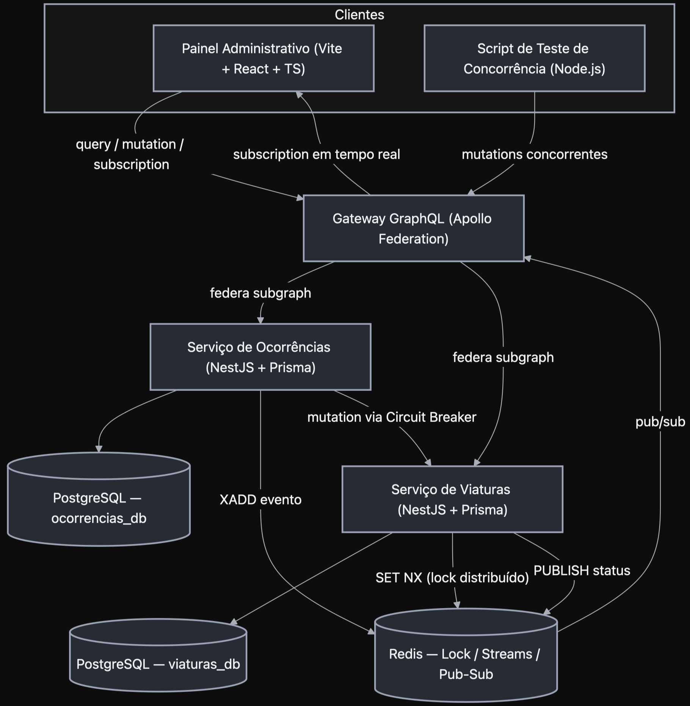
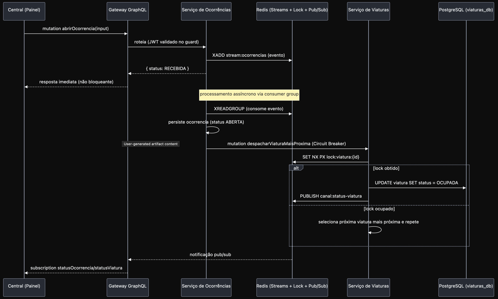

# Relatório de Planejamento Técnico e Arquitetural
## Sistema de Despacho de Viaturas (SDV) — Alocação sob Concorrência com GraphQL Federation

---

## 1. Diferencial

**Propósito.** O SDV resolve um problema clássico e crítico de sistemas distribuídos aplicado à segurança pública: garantir que, quando múltiplas centrais de despacho operam de forma concorrente e independente, a viatura mais próxima disponível seja alocada **exatamente uma vez** — sem duplicidade de despacho e sem perda de ocorrências, mesmo sob falhas parciais e múltiplas réplicas do serviço rodando simultaneamente.

**Diferenciais técnicos:**
- **Exclusão mútua real sob concorrência**, via lock distribuído no Redis (`SET NX PX`), comprovável empiricamente por um script de teste dedicado — não é uma alegação de arquitetura, é um requisito demonstrável.
- **Federação GraphQL (Apollo Federation)**: dois serviços de domínio (Ocorrências e Viaturas), cada um dono do seu subgrafo e do seu banco de dados, unificados em um único schema consultável pelo cliente através de um Gateway.
- **Tempo real nativo** via GraphQL Subscriptions (graphql-ws) alimentadas por Redis Pub/Sub — a central vê o status da frota mudar sem polling.
- **Ingestão desacoplada e durável**: `abrirOcorrencia` não bloqueia o operador esperando todo o pipeline de alocação — o evento é gravado em um Redis Stream e processado de forma assíncrona por um consumer group, com resposta imediata (`RECEBIDA`).
- **Resiliência de primeira classe**: circuit breaker na chamada entre serviços, filas duráveis, idempotência no processamento de eventos.

**Valor para o negócio e para o usuário final.** Para a operação (central de despacho), o valor é tempo de resposta e confiabilidade: nenhuma viatura é despachada duas vezes, nenhuma ocorrência é perdida se um serviço cair momentaneamente, e o operador vê o estado da frota em tempo real. Para a organização, o valor é auditabilidade (todo evento passa por um stream durável, logo é rastreável) e capacidade de operar em escala (múltiplas centrais, múltiplas réplicas, sem coordenação manual).

---

## 2. Escolha do Projeto (Domínio) e Regras de Negócio

### 2.1 Domínio e entidades centrais

O domínio é **despacho de recursos compartilhados e escassos sob concorrência real**. As entidades centrais:

| Entidade | Serviço dono | Descrição |
|---|---|---|
| `Ocorrencia` | Serviço de Ocorrências | Um chamado aberto por uma central (tipo, prioridade, localização, status) |
| `Central` | Serviço de Ocorrências | Operador/central de despacho autenticada (JWT) |
| `Viatura` | Serviço de Viaturas | Recurso físico compartilhado: posição, status, capacidade |
| `Despacho` | Serviço de Viaturas | Registro de vínculo entre uma ocorrência e a viatura alocada, com timestamp e resultado da tentativa de lock |

### 2.2 Regras de negócio (invariantes)

1. **Invariante de exclusão mútua**: uma viatura em estado `DISPONIVEL` só pode transicionar para `OCUPADA` através da posse bem-sucedida de um lock distribuído sobre seu identificador; duas transições concorrentes para a mesma viatura nunca podem ambas ter sucesso.
2. **Alocação por proximidade com fallback**: a viatura mais próxima é tentada primeiro; se o lock falhar (já disputada), o algoritmo degrada para a próxima mais próxima da lista ordenada, até esgotar candidatas ou obter sucesso.
3. **Toda ocorrência aberta deve ser persistida antes de qualquer tentativa de despacho** — a durabilidade do evento de entrada (Redis Stream) precede o processamento, garantindo que uma falha do Serviço de Ocorrências após o `ACK` ao cliente não perca a ocorrência.
4. **Idempotência de consumo**: o consumer group do stream deve tratar reentrega de mensagens (após falha de um worker) sem criar ocorrências duplicadas — chave de idempotência = ID do evento gerado na ingestão.
5. **Nenhuma ocorrência pode ser encerrada sem uma viatura vinculada ou uma justificativa explícita de cancelamento.**
6. **Uma central só pode alterar/encerrar ocorrências que ela mesma abriu** (autorização por propriedade, validada via claim do JWT).

### 2.3 Jornadas de usuário (passo a passo)

**Jornada A — Central abre uma ocorrência:**
1. Operador autentica no Painel (login → JWT armazenado em memória/contexto do Apollo Client).
2. Preenche formulário (tipo, prioridade, localização) e envia.
3. Painel dispara `mutation abrirOcorrencia` via Apollo Client contra o Gateway.
4. UI recebe resposta imediata `{ status: RECEBIDA }` e exibe o item na lista com um indicador de "processando".
5. Painel está inscrito em `subscription statusOcorrencia(id)`; quando o Serviço de Viaturas confirma o despacho, o card atualiza para `ABERTA → DESPACHADA` com o identificador da viatura, sem reload.

**Jornada B — Acompanhamento em tempo real da frota:**
1. Painel carrega `query listarViaturas` no mount para o mapa inicial.
2. Painel se inscreve em `subscription statusViatura` para atualizações incrementais de posição/status.
3. Operador visualiza no mapa a viatura mudando de `DISPONIVEL` para `OCUPADA` no instante em que o lock é confirmado no backend.

### 2.4 Usabilidade — Frontend e DX da API

- **Frontend (Vite + React + TS)**: componentes de mapa e lista desacoplados por hook de dados (`useOcorrencias`, `useViaturas`) que encapsulam Apollo Client; estado de UI local via `useState`/`useReducer`, estado de servidor via cache normalizado do Apollo (sem Redux — não se justifica para este escopo).
- **DX da API para desenvolvedores**: schema GraphQL único e fortemente tipado (contrato SDL versionado no repositório), navegável via introspecção (Apollo Sandbox/GraphQL Playground); erros padronizados em `extensions.code` (ex.: `VIATURA_INDISPONIVEL`, `UNAUTHENTICATED`); todo input tipado como `Input` com validação via `class-validator` nos DTOs de entrada dos resolvers.
- **Otimização de consultas (requisito central do TDE)**: como o Painel e o script de teste pedem exatamente os campos de que precisam em cada tela (ex.: só `placa` e `status` para uma lista simples, mas `latitude`/`longitude` para o mapa), nenhuma chamada devolve mais dados do que o necessário — ver exemplo comparativo na seção 4.6.3.

---

## 3. Repositório

### 3.1 Monorepo vs. multi-repo

**Decisão: monorepo.** Justificativa: os três serviços de backend compartilham tipos de domínio (ex.: enums de status, contratos de evento do Redis Stream) e o frontend consome diretamente o schema federado — manter tudo em um repositório com `packages/shared` reduz drift de contrato e permite CI único validando o sistema como um todo, o que é especialmente relevante para um sistema distribuído com poucos serviços (não há ainda motivo organizacional para times/deploys totalmente independentes que justificassem multi-repo).

```
sdv/
├── apps/
│   ├── gateway/                 # Apollo Gateway (composição federada)
│   ├── ocorrencias-service/     # NestJS + Prisma + PostgreSQL (subgraph)
│   ├── viaturas-service/        # NestJS + Prisma + PostgreSQL (subgraph)
│   ├── painel-frontend/         # Vite + React + TS
│   └── concurrency-test-script/ # Node.js + graphql-request (prova técnica)
├── packages/
│   └── shared/                  # enums, tipos de evento, constantes de canal Redis
├── docker-compose.yml
├── docker-compose.test.yml
└── .github/workflows/ci.yml
```

### 3.2 Estrutura de pastas — backend (`ocorrencias-service`, análogo em `viaturas-service`)

```
ocorrencias-service/
├── src/
│   ├── ocorrencias/
│   │   ├── ocorrencias.module.ts
│   │   ├── ocorrencias.resolver.ts     # implementa Query/Mutation/Subscription do SDL
│   │   ├── ocorrencias.service.ts
│   │   ├── schema.graphql              # contrato SDL — fonte da verdade do subgraph
│   │   ├── dto/
│   │   │   └── abrir-ocorrencia.input.ts  # validação class-validator do input do SDL
│   │   └── ocorrencias.consumer.ts     # worker do consumer group (Redis Streams)
│   ├── auth/
│   │   ├── jwt.strategy.ts
│   │   ├── jwt-auth.guard.ts
│   │   └── auth.module.ts
│   ├── redis/
│   │   └── redis.module.ts             # cliente Streams (ingestão)
│   ├── prisma/
│   │   └── prisma.service.ts
│   └── main.ts
└── prisma/
    └── schema.prisma
```

### 3.3 Estrutura de pastas — frontend

```
painel-frontend/
├── src/
│   ├── graphql/           # queries, mutations, subscriptions (.graphql ou gql`` tipados via codegen)
│   ├── components/
│   │   ├── Mapa/
│   │   ├── FormularioOcorrencia/
│   │   └── ListaOcorrencias/
│   ├── hooks/
│   │   ├── useOcorrencias.ts
│   │   └── useViaturas.ts
│   ├── lib/
│   │   └── apolloClient.ts
│   └── routes/
└── vite.config.ts
```

### 3.4 Branches, commits e Pull Requests

- **Branches**: trunk-based simplificado — `main` protegida, branches de feature `feat/<escopo>-<descrição>`, `fix/...`, `chore/...`.
- **Commits**: Conventional Commits (`feat(viaturas): implementa lock distribuído na alocação`), habilitando changelog automático.
- **PRs**: obrigatórios para merge em `main`; mínimo 1 aprovação; checks de CI (lint + testes) bloqueantes; template de PR exigindo descrição do impacto em contratos GraphQL quando o schema é alterado.

### 3.5 Estratégia de testes

- **Unitários (Jest)**: services isolados com Prisma mockado (`jest-mock-extended`) e cliente Redis mockado; foco em regras de negócio puras (ex.: algoritmo de fallback de proximidade).
- **Integração**: `ocorrencias-service` e `viaturas-service` subindo contra PostgreSQL e Redis reais via **Testcontainers** (ou `docker-compose.test.yml` como alternativa mais leve para CI), validando persistência e o ciclo completo do consumer group.
- **Ponta a ponta de API**: como não há REST, o papel do Supertest é feito por chamadas GraphQL de teste via `apollo-server-testing`/`graphql-request` contra o schema federado montado em memória, cobrindo `abrirOcorrencia → despacho → subscription`.
- **Teste de concorrência (prova de conceito)**: o `concurrency-test-script` roda como suíte separada no CI, disparando `Promise.all` de duas mutations simultâneas contra a mesma viatura e asserindo que exatamente uma teve sucesso — este é o teste mais importante do projeto, pois valida a invariante central do domínio.

### 3.6 CI/CD (GitHub Actions)

Pipeline por serviço, disparado em PRs e em push para `main`:
1. **Lint** (ESLint + Prettier).
2. **Testes unitários** (Jest).
3. **Testes de integração** (sobe Postgres + Redis como *services* do job, ou Testcontainers).
4. **Build** (Nest build / Vite build).
5. **Build e publish da imagem Docker** (apenas em `main`, tag = SHA curto), usando `GITHUB_TOKEN`/GHCR.
6. Segredos (`JWT_SECRET`, `DATABASE_URL`, `REDIS_URL`) injetados via **GitHub Secrets**, nunca hardcoded, com escopo por ambiente (Environments do GitHub para `staging`/`production`).

---

## 4. Arquitetura e System Design

### Modelo de consistência: CAP aplicado por operação

Este sistema não faz uma escolha única de CAP para toda a aplicação — faz escolhas **diferentes por operação**, porque o custo de errar é diferente em cada uma:

- **Alocação de viatura → CP (consistência sobre disponibilidade).** Duas centrais despachando a mesma viatura é um erro físico e irreversível — um recurso real sendo comprometido para dois destinos ao mesmo tempo. Por isso o sistema prefere **atrasar ou falhar** (tentar a próxima viatura da lista, ou não alocar nenhuma) a arriscar uma alocação dupla. É o que o lock distribuído (`SET NX PX`, seção 4.3) implementa: sem garantia de exclusividade, o sistema recua em vez de seguir de forma otimista.
- **Abertura de ocorrência → disponibilidade sobre consistência imediata.** Rejeitar ou atrasar a entrada de uma emergência é o pior cenário possível neste domínio. Por isso a ocorrência é aceita **antes** de qualquer validação/processamento completo — gravada no stream durável do Redis, respondida como `RECEBIDA` na hora, e processada de forma assíncrona depois (seção 4.3). A inconsistência tolerada é só temporal (o status muda de `RECEBIDA` para `ABERTA`/`DESPACHADA` ao longo do tempo), nunca perda do dado.

Isso também é uma instância de **PACELC**, não só de CAP: mesmo fora de uma partição de rede, há uma troca entre Latência e Consistência em operação normal — abrir ocorrência escolhe baixa latência (ACK imediato, processamento assíncrono); alocar viatura escolhe consistência mesmo pagando latência (espera a resolução do lock, tenta candidatos em sequência). Essa assimetria de propósito é o que justifica os dois fluxos terem desenhos tão diferentes nos diagramas de sequência a seguir.

### 4.1 Visão geral

Arquitetura de microsserviços com **database-per-service**, comunicação síncrona via GraphQL Federation para leitura/escrita direta e comunicação assíncrona via Redis Streams para ingestão desacoplada, mais Redis Pub/Sub para difusão de eventos em tempo real.



### 4.2 Diagrama de sequência — Abrir ocorrência e despachar



### 4.4 Diagrama de classes (descritivo)

**`Ocorrencia`**
- `id: string (uuid)`, `centralId: string`, `tipo: TipoOcorrencia`, `prioridade: Prioridade`, `latitude: number`, `longitude: number`, `status: StatusOcorrencia`, `viaturaId: string | null`, `criadoEm: DateTime`, `atualizadoEm: DateTime`
- Métodos de domínio: `abrir()`, `marcarDespachada(viaturaId)`, `encerrar(motivo?)`

**`Viatura`**
- `id: string (uuid)`, `placa: string`, `latitude: number`, `longitude: number`, `status: StatusViatura`, `capacidade: number`, `atualizadoEm: DateTime`
- Métodos de domínio: `tentarAlocar(lockToken)`, `liberar()`, `atualizarPosicao(lat, lng)`

**`Despacho`**
- `id: string (uuid)`, `ocorrenciaId: string`, `viaturaId: string`, `resultadoLock: boolean`, `criadoEm: DateTime`
- Métodos: `registrar()`

**`Central`**
- `id: string (uuid)`, `email: string`, `senhaHash: string`, `nome: string`, `criadoEm: DateTime`
- Métodos: `autenticar(senha)`, `gerarTokens()`

### 4.5 Banco de dados (PostgreSQL + Prisma) — database per service

**Relacionamentos:**
- `Central 1:N Ocorrencia` (uma central abre muitas ocorrências) — banco `ocorrencias_db`.
- `Ocorrencia 1:1 Despacho` (cada ocorrência tem no máximo um registro de despacho bem-sucedido) — vínculo lógico entre bancos, resolvido via ID (não FK física, pois são bancos separados).
- `Viatura 1:N Despacho` (uma viatura acumula histórico de despachos ao longo do tempo) — banco `viaturas_db`.

**Dicionário de dados — `ocorrencias_db`**

| Tabela | Coluna | Tipo | Constraints |
|---|---|---|---|
| `centrais` | `id` | `uuid` | PK, default `gen_random_uuid()` |
| | `email` | `varchar(255)` | UNIQUE, NOT NULL |
| | `senha_hash` | `varchar(255)` | NOT NULL |
| | `nome` | `varchar(120)` | NOT NULL |
| | `criado_em` | `timestamptz` | NOT NULL, default `now()` |
| `ocorrencias` | `id` | `uuid` | PK |
| | `central_id` | `uuid` | FK → `centrais.id`, NOT NULL, índice |
| | `tipo` | `varchar(40)` | NOT NULL |
| | `prioridade` | `smallint` | NOT NULL, CHECK (1–5) |
| | `latitude` | `double precision` | NOT NULL |
| | `longitude` | `double precision` | NOT NULL |
| | `status` | `varchar(20)` | NOT NULL, default `'RECEBIDA'`, índice |
| | `viatura_id` | `uuid` | NULLABLE (referência lógica ao outro serviço) |
| | `criado_em` | `timestamptz` | NOT NULL, default `now()`, índice |
| | `atualizado_em` | `timestamptz` | NOT NULL |

**Dicionário de dados — `viaturas_db`**

| Tabela | Coluna | Tipo | Constraints |
|---|---|---|---|
| `viaturas` | `id` | `uuid` | PK |
| | `placa` | `varchar(10)` | UNIQUE, NOT NULL |
| | `latitude` | `double precision` | NOT NULL |
| | `longitude` | `double precision` | NOT NULL |
| | `status` | `varchar(20)` | NOT NULL, default `'DISPONIVEL'`, índice |
| | `capacidade` | `smallint` | NOT NULL, default 1 |
| | `atualizado_em` | `timestamptz` | NOT NULL |
| `despachos` | `id` | `uuid` | PK |
| | `ocorrencia_id` | `uuid` | NOT NULL, índice (referência lógica) |
| | `viatura_id` | `uuid` | FK → `viaturas.id`, NOT NULL, índice |
| | `resultado_lock` | `boolean` | NOT NULL |
| | `criado_em` | `timestamptz` | NOT NULL, default `now()`, índice |

**Exemplo de `schema.prisma` (`viaturas-service`):**

```prisma
model Viatura {
  id           String   @id @default(uuid())
  placa        String   @unique
  latitude     Float
  longitude    Float
  status       String   @default("DISPONIVEL")
  capacidade   Int      @default(1)
  atualizadoEm DateTime @updatedAt

  despachos    Despacho[]

  @@index([status])
  @@map("viaturas")
}

model Despacho {
  id            String   @id @default(uuid())
  ocorrenciaId  String   @map("ocorrencia_id")
  viaturaId     String   @map("viatura_id")
  resultadoLock Boolean  @map("resultado_lock")
  criadoEm      DateTime @default(now()) @map("criado_em")

  viatura       Viatura  @relation(fields: [viaturaId], references: [id])

  @@index([ocorrenciaId])
  @@map("despachos")
}
```

### 4.6 API — Contrato GraphQL (SDL), Resolvers e Otimização de Consultas

#### 4.6.1 Contrato SDL dos subgraphs

Cada serviço expõe seu próprio contrato `.graphql`, unificado pelo Gateway via federação (`@key` marca as entidades compartilháveis entre subgraphs):

```graphql
# ocorrencias.graphql — subgraph do Serviço de Ocorrências
type Ocorrencia @key(fields: "id") {
  id: ID!
  tipo: String!
  prioridade: Int!
  latitude: Float!
  longitude: Float!
  status: StatusOcorrencia!
  viaturaId: ID
  criadoEm: String!
}

enum StatusOcorrencia {
  RECEBIDA
  ABERTA
  DESPACHADA
  ENCERRADA
}

input AbrirOcorrenciaInput {
  tipo: String!
  prioridade: Int!
  latitude: Float!
  longitude: Float!
}

type Query {
  listarOcorrencias(status: StatusOcorrencia): [Ocorrencia!]!
  consultarOcorrencia(id: ID!): Ocorrencia
}

type Mutation {
  abrirOcorrencia(input: AbrirOcorrenciaInput!): Ocorrencia!
}

type Subscription {
  statusOcorrencia(id: ID!): Ocorrencia!
}
```

```graphql
# viaturas.graphql — subgraph do Serviço de Viaturas
type Viatura @key(fields: "id") {
  id: ID!
  placa: String!
  latitude: Float!
  longitude: Float!
  status: StatusViatura!
  capacidade: Int!
}

enum StatusViatura {
  DISPONIVEL
  OCUPADA
}

type Query {
  listarViaturas(status: StatusViatura): [Viatura!]!
}

type Mutation {
  despacharViaturaMaisProxima(ocorrenciaId: ID!, latitude: Float!, longitude: Float!): Viatura
}

type Subscription {
  statusViatura: Viatura!
}
```

O Gateway compõe os dois arquivos num único schema supergraph, então um cliente (Painel ou script de teste) enxerga um único endpoint GraphQL, sem saber que existem dois serviços por trás.

#### 4.6.2 Resolvers no back-end Node.js (NestJS, schema-first)

```typescript
// ocorrencias.resolver.ts
@Resolver('Ocorrencia')
export class OcorrenciasResolver {
  constructor(
    private readonly ocorrenciasService: OcorrenciasService,
    @Inject('PUB_SUB') private readonly pubSub: RedisPubSub,
  ) {}

  @Query('listarOcorrencias')
  @UseGuards(JwtAuthGuard)
  listarOcorrencias(@Args('status') status?: StatusOcorrencia) {
    return this.ocorrenciasService.listar(status);
  }

  @Mutation('abrirOcorrencia')
  @UseGuards(JwtAuthGuard)
  abrirOcorrencia(
    @Args('input') input: AbrirOcorrenciaInput,
    @Context('centralId') centralId: string,
  ) {
    // apenas grava no stream durável e retorna RECEBIDA — não bloqueia
    return this.ocorrenciasService.receber(input, centralId);
  }

  @Subscription('statusOcorrencia')
  statusOcorrencia(@Args('id') id: string) {
    return this.pubSub.asyncIterator(`statusOcorrencia:${id}`);
  }
}
```

O `AbrirOcorrenciaInput` é uma classe validada com `class-validator` (`@IsIn([...tipos]) tipo`, `@Min(1) @Max(5) prioridade`, `@IsLatitude() latitude`, `@IsLongitude() longitude`), aplicada por um `ValidationPipe` global — mesmo padrão de validação de DTOs, só que alimentando resolvers em vez de controllers.

#### 4.6.3 Otimização de consultas — eliminando over-fetching e under-fetching

Este é o requisito central da Opção 3 do TDE. O mesmo campo `Query.listarViaturas` é reaproveitado por telas diferentes do Painel, cada uma pedindo só o que precisa — sem endpoints especializados e sem baixar dados que não serão usados:

```graphql
# Tela de lista simples do Painel: só precisa de identificação e status
query PainelListaSimples {
  listarViaturas(status: DISPONIVEL) {
    placa
    status
  }
}
```

```graphql
# Tela de mapa: precisa de coordenadas, então pede mais campos — mas ainda
# nenhum campo supérfluo (não pede capacidade, que essa tela não usa)
query PainelMapa {
  listarViaturas(status: DISPONIVEL) {
    id
    placa
    latitude
    longitude
    status
  }
}
```

Numa API REST equivalente, `GET /viaturas` tipicamente devolveria o objeto completo (todos os campos) para as duas telas — over-fetching na tela de lista simples — ou exigiria endpoints especializados (`/viaturas/resumo`, `/viaturas/mapa`) para evitar isso, aumentando a superfície de manutenção. Com GraphQL, o **mesmo resolver** serve ambos os casos porque o cliente declara o *shape* da resposta na própria query — resolvendo over-fetching sem multiplicar endpoints, e resolvendo under-fetching porque uma única chamada federada (`abrirOcorrencia` + subcampos de `Ocorrencia`) já traz tudo que uma tela de detalhe precisa, sem round-trips adicionais a outro serviço.

---

## 5. Segurança

- **AuthN/AuthZ**: JWT assinado (HS256 ou RS256) por central autenticada; `accessToken` de curta duração (15 min) + `refreshToken` (7 dias, armazenado com rotação); claims incluem `centralId` para autorização por propriedade (regra de negócio 2.2.6).
- **OWASP Top 10 aplicado a GraphQL**:
  - **Rate limiting** por IP/central no Gateway (ex.: `graphql-rate-limit` ou middleware no nível do Apollo Server).
  - **Limite de profundidade e complexidade de query** (`graphql-depth-limit`, `graphql-query-complexity`) para mitigar consultas aninhadas maliciosas — o equivalente GraphQL de proteção contra payloads abusivos.
  - **Helmet** para headers de segurança HTTP no Gateway e nos subgraphs.
  - **CORS** restrito às origens conhecidas do Painel (por ambiente).
  - Introspecção do schema **desabilitada em produção** (evita exposição desnecessária da superfície de ataque).
- **Dados em trânsito e em repouso**: TLS obrigatório entre Painel ↔ Gateway em produção; `senha_hash` sempre via bcrypt/argon2, nunca texto plano; dados sensíveis adicionais (se houver) criptografados a nível de coluna no PostgreSQL.
- **Gestão de segredos**: `JWT_SECRET`, `DATABASE_URL` (por serviço) e `REDIS_URL` via variáveis de ambiente, nunca hardcoded; **GitHub Secrets** segregados por ambiente (`dev`/`staging`/`prod`) usando GitHub Environments.
- **Menor privilégio**: usuário do PostgreSQL de cada serviço tem acesso apenas ao seu próprio schema/banco; credenciais de deploy no CI/CD escopadas ao mínimo necessário para publicar imagem e atualizar o ambiente-alvo.

---

## 6. Escalonamento

- **Backend stateless**: `ocorrencias-service` e `viaturas-service` são stateless (todo estado vive em PostgreSQL/Redis), permitindo múltiplas réplicas atrás de um load balancer sem afinidade de sessão.
- **Gatilho de scale-out**: CPU ou memória atingindo **80% de utilização** sustentada por um período curto (ex.: 2–5 min) dispara nova réplica; **scale-in** ocorre com utilização sustentada abaixo de ~30%, com *cooldown* para evitar oscilação (flapping).
- **Comportamento do load balancer durante scale-in**: conexões em andamento na instância a ser removida são drenadas (*connection draining*) antes do desligamento; novas requisições deixam de ser roteadas para ela imediatamente.
- **Banco de dados**: connection pooling (PgBouncer ou pool nativo do Prisma) para absorver picos de réplicas; réplicas de leitura para consultas de listagem (`listarOcorrencias`, `listarViaturas`), mantendo escrita centralizada no primário para preservar consistência da invariante de lock.
- **Cache**: Redis já cumpre papel de cache de estado quente da frota (posições/status), reduzindo pressão de leitura sobre o PostgreSQL nas consultas mais frequentes do Painel.
- **Redis como ponto de atenção de escala**: como o lock distribuído e os streams passam por uma única instância lógica do Redis, seu dimensionamento (ou uso de Redis Cluster/Sentinel em produção) é crítico — é o componente que, se subdimensionado, limita a escala de todo o sistema.

---

## 7. Tolerância a Falhas

- **Circuit breaker** (ex.: `opossum`) na chamada `Ocorrências → Viaturas`: após N falhas consecutivas, o circuito abre e novas tentativas de despacho falham rápido (fail-fast) em vez de acumular timeouts; ocorrências ficam retidas no stream para reprocessamento quando o circuito fechar novamente.
- **Timeouts e retries com backoff exponencial**: toda chamada entre subgraphs e ao Redis tem timeout explícito; retries limitados (ex.: 3 tentativas, backoff 200ms/400ms/800ms) para falhas transitórias, nunca para falhas de lock já resolvido (para não violar a invariante de exclusão mútua).
- **Health checks**: endpoint de *liveness* (`o processo está vivo?`) e *readiness* (`consegue falar com Postgres e Redis?`) em cada serviço, usados pelo orquestrador para não rotear tráfego a instâncias não prontas e para reiniciar instâncias travadas.
- **Redundância e failover**: múltiplas réplicas de cada serviço; em ambiente com múltiplas zonas, réplicas distribuídas entre zonas para sobreviver à perda de uma zona inteira.
- **Degradação graciosa**: se `viaturas-service` está indisponível, `ocorrencias-service` continua aceitando e persistindo ocorrências (`RECEBIDA`/`ABERTA`) — elas ficam **retidas no consumer group do stream** até o circuito fechar, em vez de a ingestão falhar por completo. O Painel mostra o status intermediário ao operador em vez de travar a UI.
- **Idempotência**: cada evento no stream carrega um `eventId` único; o worker consumidor verifica se aquele `eventId` já foi processado antes de persistir, tornando a reentrega (em caso de crash do worker antes do `XACK`) segura e sem duplicar ocorrências.
- **Mensageria assíncrona**: Redis Streams garante persistência da fila (diferente de Pub/Sub puro, que perde mensagens sem consumidor conectado); consumer groups garantem que cada evento seja processado por exatamente um worker, com reentrega automática de mensagens não confirmadas (*pending entries list*).

---

## 8. Serviço e Nomenclatura (DNS)

- **Domínios por ambiente**: `api.sdv.exemplo.com` (Gateway em produção), `staging.api.sdv.exemplo.com`, `dev.api.sdv.exemplo.com` — subdomínio de ambiente sempre antes do serviço.
- **Resolução interna (Docker Compose)**: serviços se resolvem por **nome do serviço na rede do Compose**, nunca por IP fixo — ex.: `ocorrencias-service` alcança o Redis em `redis://redis:6379` e o Postgres em `postgres-ocorrencias:5432`; o Gateway alcança os subgraphs em `http://ocorrencias-service:4001/graphql` e `http://viaturas-service:4002/graphql`.
- **Convenção de nomes de containers**: `<serviço>-<papel>` (ex.: `ocorrencias-service`, `viaturas-service`, `postgres-ocorrencias`, `postgres-viaturas`, `redis`, `gateway`), consistente com os nomes usados nas variáveis de ambiente (`DATABASE_URL`, `REDIS_URL`) para que dev/staging/prod só troquem o host, nunca a convenção.
- **Padronização de recursos distribuídos**:
  - Canais Redis Pub/Sub: `canal:status-viatura`, `canal:status-ocorrencia`.
  - Streams: `stream:ocorrencias` com consumer group `cg:ocorrencias-service`.
  - Chaves de lock: `lock:viatura:{id}`.
  - Campos GraphQL federados seguem `camelCase`, tipos em `PascalCase`, mutations como verbo+entidade (`abrirOcorrencia`, `despacharViaturaMaisProxima`) — consistência que facilita tanto o DX de quem consome o schema quanto a leitura dos logs/eventos correlacionados entre serviços.
